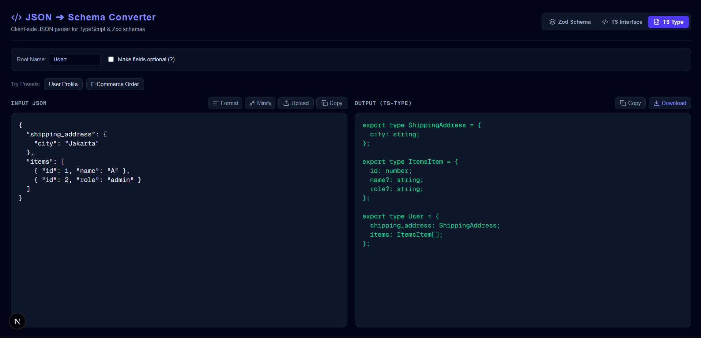

# ⚡ JSON to TypeScript & Zod Schema Converter

A lightweight, developer-focused micro-tool designed to instantly convert raw JSON API payloads into **TypeScript Interfaces**, **TypeScript Types**, and **Zod Validation Schemas**. 

Built with 100% client-side privacy, smart format detection, and automated JSON repair mechanisms.

 <!-- Upload screenshot kamu ke folder /public -->

---

## ✨ Features

- 🔒 **100% Client-Side & Private:** Zero network requests. All parsing and AST generation happen entirely inside your browser.
- ⚡ **Zod Schema Engine:** Automatically detects special string formats (`email`, `uuid`, `datetime`, `url`) and attaches validation chains (e.g., `z.string().email()`).
- 🧠 **Smart Array Union Merging:** Intelligently analyzes heterogeneous objects inside arrays and resolves them into unified types with optional property flags.
- 🧹 **Auto-Fix Broken JSON:** Tolerates unquoted keys, single quotes, trailing commas, and Javascript comments using `JSON5` fallback parsing.
- 🎨 **IDE-Inspired Split Interface:** High-contrast dark theme, live syntax validation, code formatting (Prettify/Minify), and file export (`.ts`).
- 💾 **State Persistence:** Automatically syncs your active state and editor preferences using `useSyncExternalStore` and `localStorage`.

---

## 🛠️ Tech Stack

- **Framework:** Next.js 15+ (App Router)
- **Language:** TypeScript
- **Styling:** Tailwind CSS
- **Icons:** Lucide React
- **Parsing Engine:** Native AST logic & JSON5
- **Testing:** Vitest

---

## 🚀 Getting Started

### 1. Clone the repository
```bash
git clone https://github.com/EghoPratama/json-to-schema
cd json-to-schema
```

### 2. Install dependencies
```bash
npm install
```

### 3. Run development server
```bash
npm run dev
```

Open [http://localhost:3000](http://localhost:3000) in your browser to view the application.

---

## 🧪 Running Unit Tests

The core conversion engine and UX utilities are fully tested with Vitest.

```bash
# Run unit tests
npm run test
```

---

## 📄 License

MIT © [EghoPratama](https://github.com/EghoPratama)